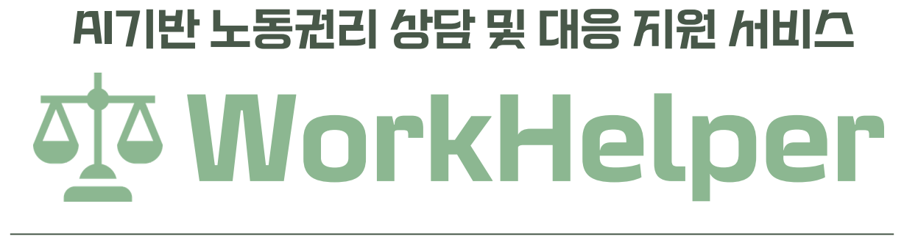
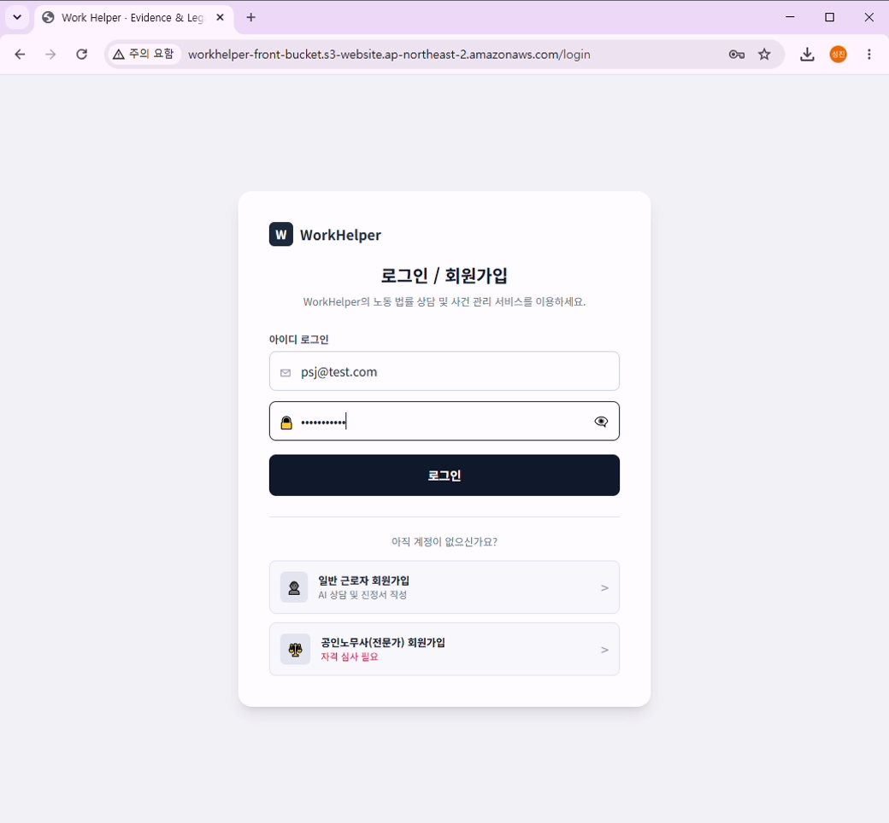
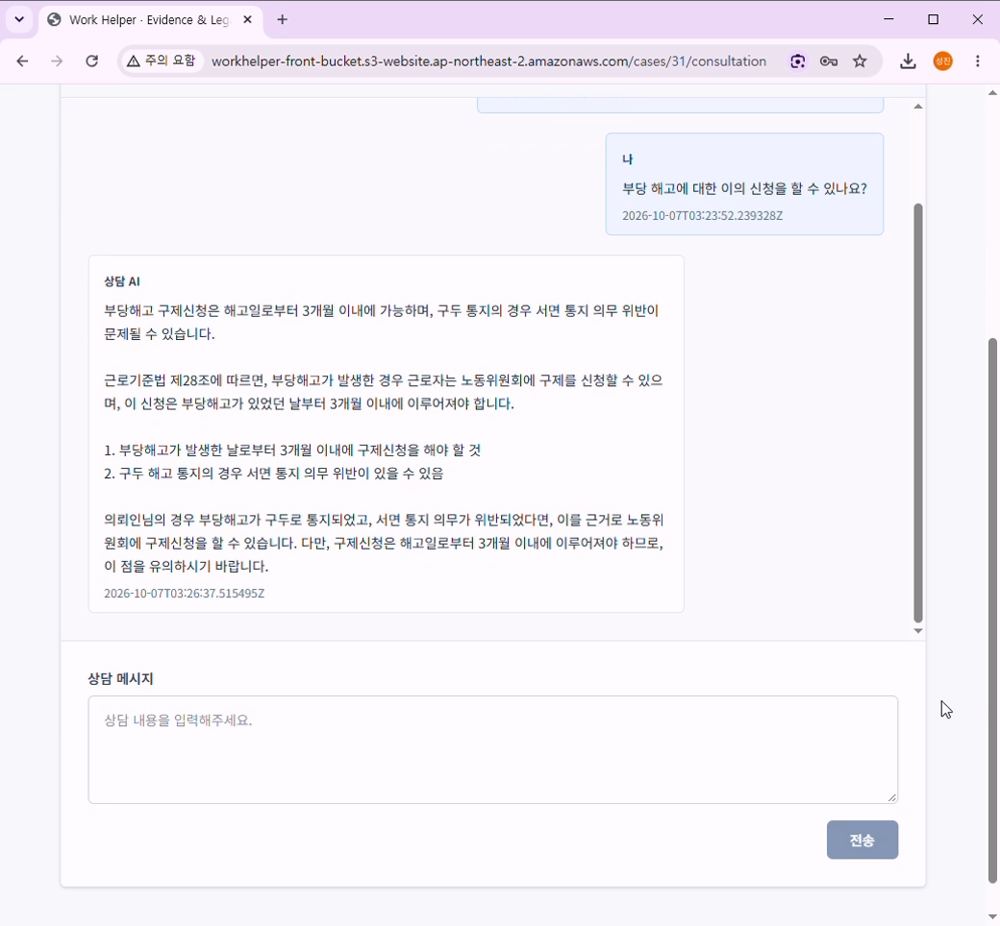
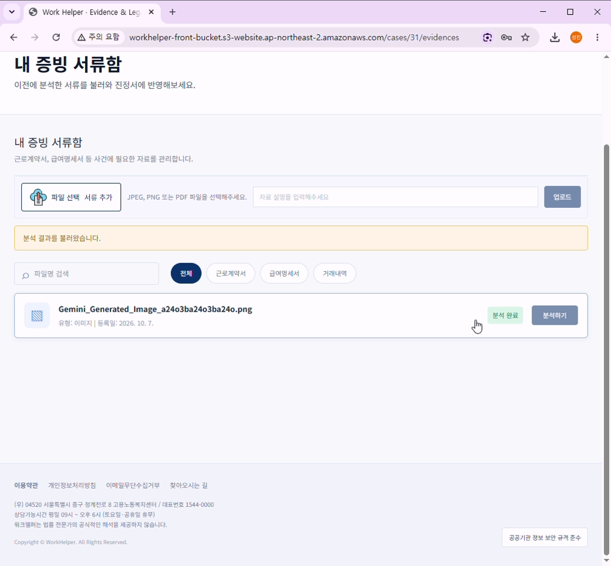
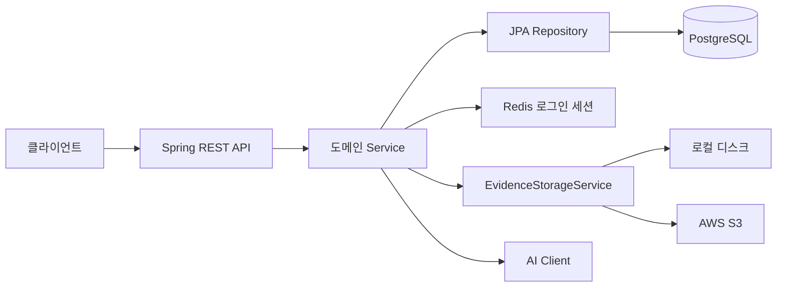

<div align="center"><b><h3>


</br>


</br>


</br>


</br>


</br></br>
AI를 활용해 노동자의 권리를 보호하고 피해 구제 절차를 지원합니다.</br>
<a href="http://workhelper-front-bucket.s3-website.ap-northeast-2.amazonaws.com/">서비스 접속</a>
 · 
<a href="https://youtu.be/kuHNYSx85pk">시연 영상</a>
</br></br>

<table border="1" width="75%">
  <tr>
    <td colspan="3" align="center"><b>GitHub Repository</b></td>
  </tr>
  <tr>
    <td align="center" width="33.33%"><a href="https://github.com/workhelper-team/work-helper-frontend">프론트엔드</a></td>
    <td align="center" width="33.33%"><a href="https://github.com/workhelper-team/work-helper-backend">백엔드</a></td>
    <td align="center" width="33.33%"><a href="https://github.com/workhelper-team/work-helper-ai">AI 서버</a></td>
  </tr>
</table>
</br>
</h3></b></div>

# 프로젝트 보고서
| 보고서 | 별첨 |
| :---: | :---: |
| [](https://drive.google.com/file/d/1z77QWlTrn-q8-e5Nt0XfNtqUGK486Avh/view?usp=sharing) | [](https://drive.google.com/file/d/1F5LqKwR31_nzdSNEVt11HtvXAsZL0L_8/view?usp=sharing) |

# WorkHelper Backend
## 프로젝트 개요

노동 사건 관리와 상담, 증거 분석, 문서 생성을 지원하는 WorkHelper의 Spring Boot 백엔드입니다.

[서비스 접속 링크](http://workhelper-front-bucket.s3-website.ap-northeast-2.amazonaws.com/)

## 팀 구성 및 역할 분담

| 담당자 | 구분 | 역할 |
| --- | --- | --- |
| 박성진(PM) | AI 서버 | 내부 API, OCR, LLM 워크플로우 및 RAG 개발, AI 서버 CI/CD, AI 서버 버전 관리 |
| 권순현(PL) | AI 서버 | 법령·판례 수집, 파싱, 임베딩 및 DB 적재, RAG, AI 채팅상담 개발, 백엔드 CI/CD |
| 이규원(AA) | 프론트/백 | DB 설계 및 구축, 외부 API 연동, 내부 AI API 연동, 프론트엔드/백엔드 버전 관리 |
| 홍동연 | 프론트/백 | AI 채팅상담 화면구현, 사건목록 화면구현, 화면 UI 구현 |
| 홍은지 | 프론트/백 | 로그인 및 회원가입 화면구현, JWT + Redis Session 기반 인증 세션 구현, React Router 기반 라우팅 제어 |
| 홍은영 | 프론트/백 | 전문가 QnA 화면구현, JWT 기반 사용자 권한별 분기 처리, S3 파일 업로드 로직 구현, 통합 테스트 |

## 시연 영상 및 서비스 화면

### 시연 영상
[](https://youtu.be/kuHNYSx85pk)

### 서비스 화면

| 메인화면 | 로그인 화면 | 사건 관리 화면 |
| :---: | :---: | :---: |
|  |  |  |

| AI 채팅 상담 화면 | 증거 서류 분석 화면 | 진정서 작성 초안 화면 |
| :---: | :---: | :---: |
|  |  |  |

## 주요 기능

- 회원가입, 로그인, JWT 인증 및 Redis 기반 로그인 세션 관리
- 노동 사건 생성, 목록·상세 조회 및 수정
- 사건별 증거 파일 업로드, 조회, 수정 및 삭제
- 증거 분석 요청과 상담 메시지 송수신
- 사건 관련 문서 관리 및 진정서 PDF 다운로드
- 전문가 질문 등록·조회 및 전문가 답변 확인

## 기술 스택

| 구분 | 기술 |
| --- | --- |
| Language | Java 17 |
| Framework | Spring Boot 3.5.16, Spring Web, Spring Data JPA, Spring Validation, Spring Security |
| Build | Gradle Wrapper 8.11 |
| Database | PostgreSQL 18 |
| Session | Redis-compatible session store (AWS ElastiCache / Valkey) |
| Authentication | Spring Security, JWT (JJWT 0.11.5) |
| Storage | Local disk, AWS S3 (AWS SDK 2.31.68) |
| AI 연동 | [FastAPI AI Server](https://github.com/workhelper-team/work-helper-ai) |
| PDF | Apache PDFBox 3.0.8 |
| Test | Spring Boot Test, JUnit Platform |

## 서비스 아키텍처



## 프로젝트 디렉토리 구조

```text
src
├─ main
│  ├─ java/com/workhelper
│  │  ├─ domain
│  │  │  ├─ auth          # 회원가입, 로그인, 로그아웃
│  │  │  ├─ user          # 사용자
│  │  │  ├─ laborcase     # 노동 사건
│  │  │  ├─ consultation  # 상담 메시지
│  │  │  ├─ evidence      # 증거 자료 및 분석
│  │  │  ├─ document      # 문서 및 PDF 생성
│  │  │  ├─ expert        # 전문가 Q&A 및 프로필
│  │  │  └─ legal         # 법률자료
│  │  ├─ global
│  │  │  ├─ config        # Security, CORS 설정
│  │  │  ├─ error         # 공통 오류 처리
│  │  │  └─ security      # JWT, Redis 세션
│  │  └─ infra
│  │     ├─ ai            # AI Client 및 DTO
│  │     └─ storage       # 로컬/S3 저장소
│  └─ resources
│     ├─ application.yml
│     ├─ fonts
│     └─ pdf
└─ test/java/com/workhelper
```

## 실행 방법

### 사전 준비

- JDK 17
- PostgreSQL 및 애플리케이션용 데이터베이스
- 로그인·인증 기능 사용 시 Redis

Hibernate는 `ddl-auto: validate`로 설정되어 있습니다. 실행 전에 데이터베이스 Schema를 별도 DDL로 준비해야 하며, DDL은 이 저장소에 포함되어 있지 않습니다.

### 환경 변수

필수 데이터베이스 및 JWT 설정:

```text
DB_URL=jdbc:postgresql://localhost:5432/workhelper
DB_USERNAME=postgres
DB_PASSWORD=<local-secret>
JWT_SECRET=<secret-key>
```

선택 설정의 기본값 및 목적:

| 변수 | 기본값 | 설명 |
| --- | --- | --- |
| `REDIS_HOST` | `localhost` | Redis 호스트 |
| `REDIS_PORT` | `6379` | Redis 포트 |
| `REDIS_USERNAME` | 빈 값 | Redis 인증 사용자 |
| `REDIS_PASSWORD` | 빈 값 | Redis 비밀번호 |
| `REDIS_SSL_ENABLED` | `false` | Redis TLS 사용 여부 |
| `AI_BASE_URL` | `http://localhost:8000` | AI 연동 서버 주소 |
| `STORAGE_TYPE` | `local` | 증거 파일 저장 방식 (`local` 또는 S3 설정) |
| `STORAGE_LOCAL_ROOT` | `uploads` | 로컬 파일 저장 경로 |
| `STORAGE_S3_BUCKET` | 빈 값 | S3 버킷 |
| `AWS_REGION` | `ap-northeast-2` | AWS 리전 |

### 빌드 및 실행

Windows PowerShell:

```powershell
.\gradlew.bat clean build
.\gradlew.bat bootRun
```

Unix 계열:

```bash
./gradlew clean build
./gradlew bootRun
```
